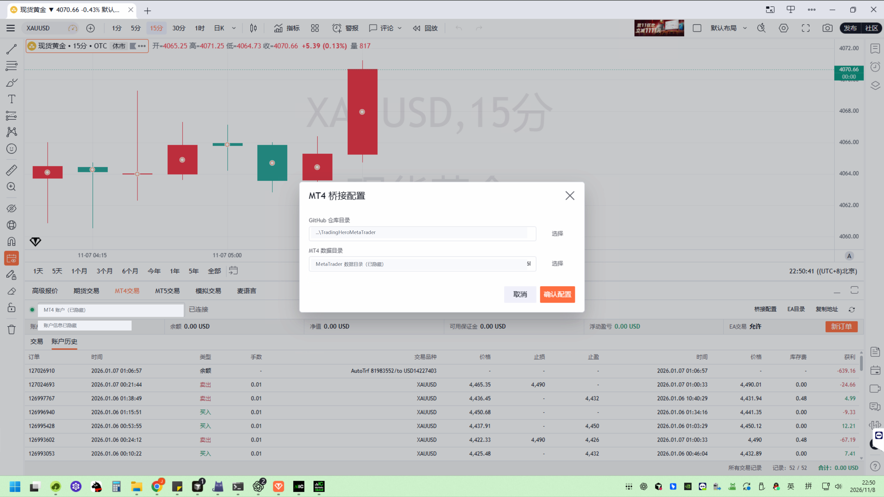
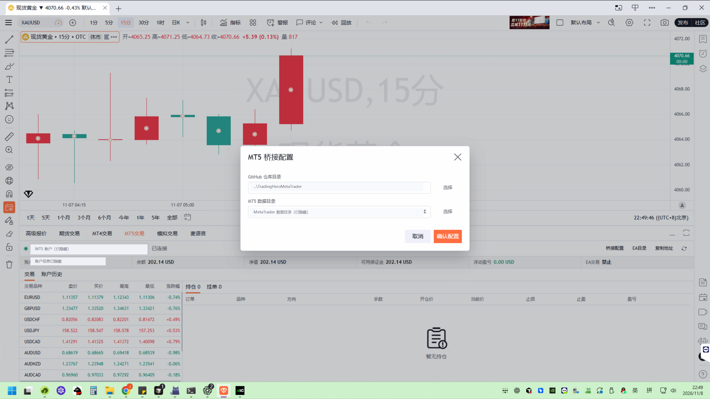

# TradingHero MetaTrader Bridge

TradingHero MetaTrader Bridge 用于在 Windows 版 TradingHero 中连接本机 MetaTrader 4 和 MetaTrader 5，实现以下功能：

- 查看交易账户、市场报价、持仓、挂单和账户历史。
- 从 TradingHero 发起市价开仓和挂单。
- 平仓、撤单以及全部平仓并撤单。
- 查看 MT4/MT5 返回的交易品种及合约属性。

## 效果预览

### MT4 桥接配置



### MT5 桥接配置



## 工作方式

TradingHero 在本机启动两个只监听回环地址的网关：

| 平台 | 本地网关                      | EA 文件                     |
| ---- | ----------------------------- | --------------------------- |
| MT4  | `http://127.0.0.1`（端口 80） | `mt4/TradingHeroBridge.ex4` |
| MT5  | `http://127.0.0.1:81`         | `mt5/TradingHeroBridge.ex5` |

EA 通过 MetaTrader 的 `WebRequest` 与本地网关交换账户、报价和订单数据。TradingHero 会自动生成并加密保存 Token，用户无需手工配置；所有请求只访问本机回环地址，不会连接本仓库提供的远程交易服务器。

## 快速开始

1. 在 `TradingHero.exe` 所在目录创建 `config.json`。
2. 参考 [config.example.json](config.example.json) 添加需要启用的平台，只需配置 `feat`。
3. 重启 TradingHero，在 MT4/MT5 交易面板点击“桥接配置”。
4. 选择本仓库目录和 MetaTrader 数据目录，TradingHero 会自动生成 Token 并执行 `launch.bat`。
5. `launch.bat` 只复制 `TradingHeroBridge.ex4/ex5`，并在 MetaTrader 数据目录中生成 `bridge.conf`。
6. 启动 MetaTrader，允许对应的 WebRequest 地址，并把 EA 加载到任意一个保持打开的图表。
7. 如需真实交易，将 EA 参数 `AllowLiveTrading` 设置为 `true`，同时开启 MetaTrader 的自动/算法交易。

详细步骤：

- [MT4 部署指南](docs/MT4部署指南.md)
- [MT5 部署指南](docs/MT5部署指南.md)
- [常见问题](docs/常见问题.md)

## 仓库结构

```text
TradingHeroMetaTrader/
├─ mt4/
│  ├─ TradingHeroBridge.mq4
│  └─ TradingHeroBridge.ex4
├─ mt5/
│  ├─ TradingHeroBridge.mq5
│  └─ TradingHeroBridge.ex5
├─ docs/
│  ├─ images/
│  │  ├─ mt4-bridge-config.png
│  │  ├─ mt5-bridge-config.png
│  │  ├─ mt5-webrequest-settings.png
│  │  ├─ mt5-ea-general-settings.png
│  │  └─ mt5-ea-input-settings.png
│  ├─ MT4部署指南.md
│  ├─ MT5部署指南.md
│  └─ 常见问题.md
├─ config.example.json
├─ launch.bat
└─ README.md
```

## 安全提示

- 不要把真实 `config.json`、`bridge.conf`、Token、交易账号或日志提交到 GitHub。
- 本地网关只能监听 `127.0.0.1`，不要通过端口转发、反向代理或防火墙映射将其暴露到局域网或公网。
- `AllowLiveTrading` 默认关闭。启用前请先使用模拟账户验证品种、手数、止损、止盈和挂单价格。
- Token 由 TradingHero 自动生成并使用 Windows 安全存储加密保存，不要复制或提交 MetaTrader 数据目录中的 `bridge.conf`。

## 源码与编译文件

仓库同时提供 MQL 源码和已编译 EA，但自动部署只复制 `TradingHeroBridge.ex4/ex5`。不同经纪商终端的 MetaTrader Build 版本可能存在兼容差异；如果已编译文件无法加载，请使用对应终端自带的 MetaEditor 重新编译 `.mq4` 或 `.mq5` 文件。
